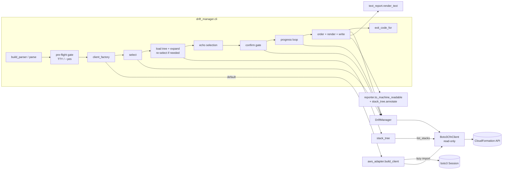
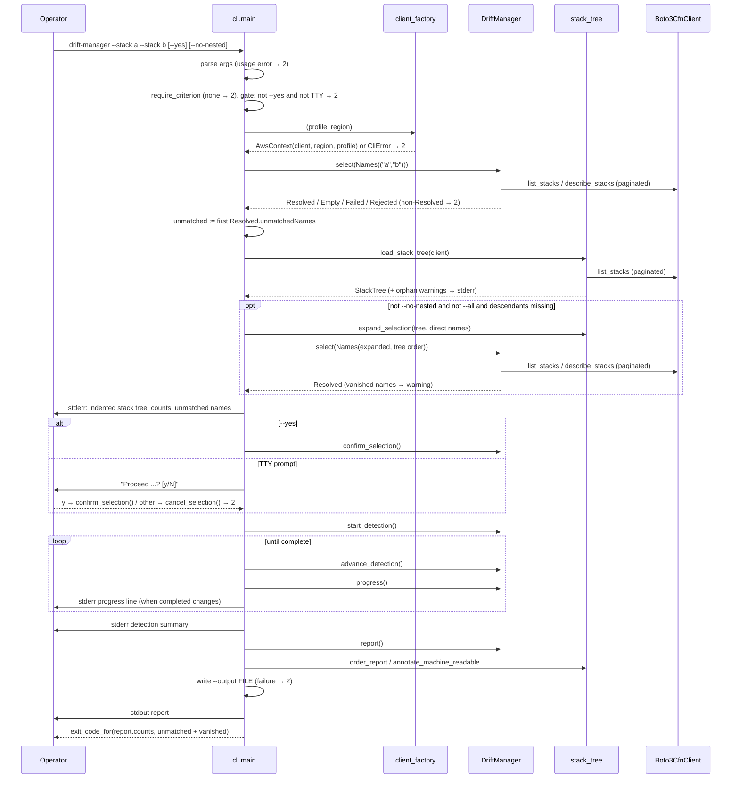

# Design Document: AWS CLI Access

## Overview

This feature adds a read-only `drift-manager` command that runs the existing `DriftManager` pipeline (select → confirm → detect → report) against one real AWS account and region. It adds five modules and no changes to the core pipeline (`selector`, `detector`, `manager`, `reporter`, `models`):

- `aws_adapter.py`: `Boto3CfnClient`, a read-only `CfnClient` over an injected boto3 CloudFormation client, plus `build_client()` which creates the session and translates credential and config errors.
- `cli.py`: argparse parser, `main()` with injectable streams, client factory, and clock, the confirmation gate, nested-stack expansion, the progress loop, and exit-code computation.
- `stack_tree.py`: the nested-stack hierarchy (`StackTree`) built from a `list_stacks` inventory, plus pure helpers for expansion, tree ordering, layout, the descendant-drift marker, and the JSON parent/root annotation.
- `text_report.py`: the Human_Report renderer, the stderr selection listing, and the stderr detection-summary renderer.
- `__main__.py`: `python -m drift_manager` entry.

boto3 is imported lazily inside `build_client()`, so `import drift_manager`, `drift_manager.cli`, `drift_manager.aws_adapter`, and `drift_manager.stack_tree` all work without boto3 installed.

### Findings from the existing code that shape the design

Reading `selector.py`, `models.py`, `manager.py`, `reporter.py`, `detector.py`, and `cfn_client.py` turned up these constraints:

1. `SelectionCriterion = Union[Names, Tags, Region]`. A run resolves exactly one criterion. Names, tags, and region cannot be combined in one call to `StackSelector.resolve`.
2. Only the `Region` criterion forwards a `Region=` keyword to `list_stacks` / `describe_stacks` (`StackSelector._paginate`). boto3 has no `Region` parameter and rejects unknown parameters, so the adapter has to consume it.
3. `StackSelector._load_inventory` reads `summary.get("Region", "")`. Real boto3 `StackSummaries` have no `Region` key, so without help every stack would have region `""`, and `_resolve_region` would return `EmptySelection` for every region.
4. boto3 `list_stacks` without `StackStatusFilter` also returns deleted stacks (`DELETE_COMPLETE`, kept for 90 days). `_load_inventory` uses a dict keyed by name, so a deleted stack can share a name with a live stack. Depending on page order, the live stack can be shadowed and then skipped as `NOT_CHECKED`.
5. `StackSelector._paginate` and `StackDetection._fetch_drifted_resources` already leave out `NextToken` when it is `None`. Other callers might not, and boto3 rejects `None` parameter values, so the adapter strips `None`-valued kwargs as a defensive step.
6. Nested-stack data. boto3 `StackSummaries` and `Stacks` entries carry `ParentId` and `RootId` (stack ARNs) for nested stacks. The adapter returns `{**summary, "Region": ...}`, so both keys pass through unchanged. The selector's `Stack` model keeps `stackId` (from `StackId`) but drops `ParentId` / `RootId`. The hierarchy therefore can't be read from a `Resolved` result and needs its own inventory read (see [Nested stacks](#nested-stacks)).
7. `DriftManager.select()` is allowed again from `RESOLVED`, and it replaces the resolved set. `Names` resolution keeps the input order and drops duplicate names. `BulkDetection` emits outcomes in confirmed-set order, and `reporter.report` keeps that order, so report order equals the order of the confirmed set.
8. `DriftManager._on_detection_complete` passes `confirmed_set.unmatchedNames` to `summarize_detection`. After a re-selection, that reflects the second selection, not the operator's input.
9. `reporter.from_machine_readable` reads only the keys it knows from each stack entry (`stackName`, `driftStatus`, `driftedResources`) and ignores the rest. Additive per-entry keys keep `schemaVersion` 1 and the round trip intact.
10. CloudFormation drift detection on a parent stack does not cover its nested stacks. Each nested stack has to be detected on its own, which `DetectStackDrift` supports by name.

The adapter handles 2–5. Item 1 decides the CLI selection mapping (see [Selection mapping](#selection-mapping)). Items 6–10 decide the nested-stack design.

## Architecture



Streams:

- stdout gets only the report: text, or JSON with nothing else in JSON mode.
- stderr gets the context line, orphan and vanished-stack warnings, the resolved stack tree and unmatched names, the prompt, progress, the detection summary, and errors.
- The `--output FILE` gets the same report bytes as stdout.

### Run sequence



## Components and Interfaces

### Module layout

```
src/drift_manager/
  __init__.py          (unchanged; no boto3 import)
  __main__.py          NEW  python -m drift_manager
  aws_adapter.py       NEW  Boto3CfnClient, ReadOnlyAdapterError, AwsContext, build_client, CliError
  cli.py               NEW  build_parser, main, exit_code_for, build_criterion, parse_tag
  stack_tree.py        NEW  StackTree, StackNode, OrphanWarning, build_stack_tree, load_stack_tree,
                            expand_selection, layout, order_report, nested_drift_markers,
                            annotate_machine_readable
  text_report.py       NEW  render_text, render_summary, render_selection, render_orphan_warning
tests/
  fakes.py                           EXTENDED (additive): optional parent_id / root_id on ScriptedStack
  strategies_tree.py                 NEW  forest / orphan / status strategies
  test_aws_adapter_stubber.py        Stubber tests per Read_Method / Mutating_Method
  test_aws_adapter_prop_forwarding.py
  test_aws_adapter_prop_region.py
  test_aws_adapter_prop_readonly.py
  test_build_client.py               fake session factory: profile/region/credentials/boto3-missing
  test_cli_args.py                   parser examples, usage errors, --all / --no-nested
  test_cli_prop_tags.py
  test_cli_prop_gating.py
  test_cli_prop_run_contract.py      JSON round-trip, --output, exit code, no mutations
  test_cli_prop_progress.py
  test_cli_prop_errors.py
  test_cli_prop_credentials.py
  test_cli_prop_nested_run.py        expansion, --no-nested, --all, once-per-stack, nested exit codes
  test_cli_scenarios.py              10.3 / 10.4 scenarios as named examples
  test_cli_nested_scenarios.py       10.5 scenarios as named examples
  test_exit_code_prop.py
  test_stack_tree_prop_hierarchy.py
  test_stack_tree_prop_expansion.py
  test_stack_tree_prop_order.py
  test_stack_tree_prop_orphans.py
  test_stack_tree_prop_json.py
  test_text_report_prop.py
  test_text_report_prop_tree.py      indentation, counts, descendant-drift marker
  test_packaging.py                  pyproject entries, import without boto3, python -m
```

`CliError` lives in `aws_adapter.py` so `build_client` can raise it without importing `cli.py`, which avoids a circular import. `cli.py` re-exports it.

### `aws_adapter.py`

```python
from __future__ import annotations

from dataclasses import dataclass
from typing import Any, Callable, Optional

from .cfn_client import CfnClient

#: Statuses removed from list_stacks responses (see "Findings", item 4).
_HIDDEN_STACK_STATUSES = frozenset({"DELETE_COMPLETE"})

INSTALL_HINT = "boto3 is not installed; install it with: pip install 'drift-manager[aws]'"


class CliError(Exception):
    """An expected, user-facing failure. Rendered as one stderr line."""

    def __init__(self, message: str, exit_code: int = 2) -> None:
        super().__init__(message)
        self.exit_code = exit_code


class ReadOnlyAdapterError(RuntimeError):
    """Raised when a Mutating_Method is called on the read-only adapter."""


class RegionMismatchError(ValueError):
    """A caller asked for a region other than the one this client is bound to."""


def _clean(kwargs: dict[str, Any]) -> dict[str, Any]:
    """Drop None-valued kwargs; boto3 rejects None parameter values."""
    return {k: v for k, v in kwargs.items() if v is not None}


class Boto3CfnClient:
    """Read-only CfnClient over an injected boto3 CloudFormation client."""

    def __init__(self, client: Any, region: str) -> None:
        self._client = client
        self._region = region

    @property
    def region(self) -> str:
        return self._region

    # -- Read_Methods --------------------------------------------------------

    def list_stacks(self, *, NextToken: Optional[str] = None, **kwargs: Any) -> dict[str, Any]:
        params = self._scope({"NextToken": NextToken, **kwargs})
        response = self._client.list_stacks(**params)
        summaries = [
            {**s, "Region": self._region}          # ParentId / RootId pass through
            for s in response.get("StackSummaries", [])
            if s.get("StackStatus") not in _HIDDEN_STACK_STATUSES
        ]
        return {**response, "StackSummaries": summaries}

    def describe_stacks(self, *, StackName: Optional[str] = None,
                        NextToken: Optional[str] = None, **kwargs: Any) -> dict[str, Any]:
        params = self._scope({"StackName": StackName, "NextToken": NextToken, **kwargs})
        response = self._client.describe_stacks(**params)
        stacks = [{**s, "Region": self._region} for s in response.get("Stacks", [])]
        return {**response, "Stacks": stacks}

    def detect_stack_drift(self, *, StackName: str, **kwargs: Any) -> dict[str, Any]:
        return self._client.detect_stack_drift(**self._scope({"StackName": StackName, **kwargs}))

    def describe_stack_drift_detection_status(self, *, StackDriftDetectionId: str,
                                              **kwargs: Any) -> dict[str, Any]:
        return self._client.describe_stack_drift_detection_status(
            **self._scope({"StackDriftDetectionId": StackDriftDetectionId, **kwargs}))

    def describe_stack_resource_drifts(self, *, StackName: str,
                                       NextToken: Optional[str] = None,
                                       **kwargs: Any) -> dict[str, Any]:
        return self._client.describe_stack_resource_drifts(
            **self._scope({"StackName": StackName, "NextToken": NextToken, **kwargs}))

    # -- Mutating_Methods: always refused ------------------------------------

    def create_change_set(self, **kwargs: Any) -> dict[str, Any]:
        raise ReadOnlyAdapterError("Boto3CfnClient is read-only: create_change_set is not permitted")

    def execute_change_set(self, **kwargs: Any) -> dict[str, Any]:
        raise ReadOnlyAdapterError("Boto3CfnClient is read-only: execute_change_set is not permitted")

    def update_stack(self, **kwargs: Any) -> dict[str, Any]:
        raise ReadOnlyAdapterError("Boto3CfnClient is read-only: update_stack is not permitted")

    # -- Helpers -------------------------------------------------------------

    def _scope(self, kwargs: dict[str, Any]) -> dict[str, Any]:
        """Strip None values and consume the selector's Region kwarg."""
        params = _clean(kwargs)
        requested = params.pop("Region", None)
        if requested is not None and requested != self._region:
            raise RegionMismatchError(
                f"client is bound to region {self._region!r}; "
                f"cannot query region {requested!r}")
        return params
```

Notes:

- Only the five Read_Methods and three Mutating_Methods exist on the class. There is no `__getattr__` pass-through, so no other boto3 operation can be reached through the adapter.
- The mutating stubs take `**kwargs` only, which keeps them compatible with the protocol's keyword-only signatures. `isinstance(adapter, CfnClient)` checks method presence only, because the protocol is `runtime_checkable`.
- A `RegionMismatchError` raised during `Region` resolution is caught by `StackSelector._resolve_region` and becomes `FailedSelection`. The CLI only ever sends the bound region, so in practice this is a guard.
- botocore `ClientError` exceptions are not caught. `retry.is_transient_error` reads `exc.response["Error"]["Code"]`, so throttling (`Throttling`) is retried by the existing `call_with_retry`, and other codes become `Unknown(reason)` in the detector (Req 3.4).
- The adapter needs no change for nested stacks. `ParentId` and `RootId` already pass through because entries are copied with `{**s, ...}`. The Stubber test for `list_stacks` includes a nested summary to pin this down.

#### `build_client`

```python
@dataclass(frozen=True)
class AwsContext:
    client: CfnClient
    region: str
    profile: Optional[str]   # None means "default credential chain"


def build_client(profile: Optional[str], region: Optional[str], *,
                 session_factory: Optional[Callable[..., Any]] = None) -> AwsContext:
    try:
        import boto3
        from botocore.config import Config
        from botocore.exceptions import BotoCoreError, NoCredentialsError, ProfileNotFound
    except ImportError as exc:
        raise CliError(INSTALL_HINT) from exc

    factory = session_factory or boto3.Session
    try:
        session = factory(profile_name=profile)
    except ProfileNotFound:
        raise CliError(f"AWS profile {profile!r} was not found") from None

    resolved_region = region or session.region_name
    if not resolved_region:
        raise CliError("an AWS region is required: pass --region or configure a default region")

    try:
        credentials = session.get_credentials()
    except (NoCredentialsError, BotoCoreError) as exc:
        # Class name only: never format credential objects or provider internals.
        raise CliError(f"AWS credentials could not be resolved ({type(exc).__name__})") from None
    if credentials is None:
        raise CliError("AWS credentials were not found for "
                       + (f"profile {profile!r}" if profile else "the default credential chain"))

    config = Config(retries={"mode": "standard", "max_attempts": 3},
                    connect_timeout=10, read_timeout=30)
    client = session.client("cloudformation", region_name=resolved_region, config=config)
    return AwsContext(client=Boto3CfnClient(client, resolved_region),
                      region=resolved_region, profile=profile)
```

- Credential check: `session.get_credentials()` returning `None` means nothing was found. The returned object is only compared to `None`. Its attributes are never read, formatted, or logged (Req 2.9).
- Region check: `--region` wins, otherwise `session.region_name`, which reads `AWS_REGION` / `AWS_DEFAULT_REGION` / the profile's config. An explicit check gives a clearer message than waiting for botocore's `NoRegionError` from `session.client()`.
- Retries: botocore runs in `standard` mode with 3 attempts. `StackSelector` inventory calls (`list_stacks` / `describe_stacks`) and the `load_stack_tree` inventory call have no app-level retry, so botocore covers throttling there. Detection calls are also retried by `call_with_retry` on top of that. botocore's sleeps don't go through the injected clock, so in the worst case a stack's 300 s window overruns by a few seconds. That's acceptable for a CLI and is documented here.
- `session_factory` is injectable so tests can supply a fake session without network access or real credentials.

### `cli.py`

#### Parser

```
drift-manager [--profile NAME] [--region REGION]
              (--stack NAME [--stack NAME ...] | --tag KEY=VALUE [--tag ...] | --all)
              [--no-nested] [--yes] [--format {text,json}] [--output FILE]
```

| Option | Dest | Notes |
|---|---|---|
| `--profile NAME` | `profile` | Default `None` → credential chain |
| `--region REGION` | `region` | Default `None` → chain |
| `--stack NAME` | `stacks` (`action="append"`) | Repeatable |
| `--tag KEY=VALUE` | `tags` (`action="append", type=parse_tag`) | Repeatable; AND semantics (selector) |
| `--all` | `all_stacks` (`store_true`) | Every live stack in the Bound_Region (Req 1.5, 4.10) |
| `--no-nested` | `no_nested` (`store_true`) | Disables nested-stack expansion (Req 1.9, 11.2); no effect with `--all` |
| `--yes` / `-y` | `yes` | Skips prompt |
| `--format` | `format` | `choices=("text","json")`, default `text` |
| `--output FILE` | `output` | Report also written to FILE |

`--stack`, `--tag`, and `--all` are in one argparse mutually exclusive group. Supplying two or more gives argparse's usage error (`argument --all: not allowed with argument --stack`) and exit 2 (Req 1.8). Running with none of them returns exit 2 with `exactly one selection option is required: pass --stack, --tag, or --all` (Req 1.7). The group is not marked `required=True` so that message can be worded exactly. There are no reconcile, adopt, or align options (Req 8.2).

`--no-nested` with `--all` is accepted and has no effect, because `--all` already includes every nested stack (Req 11.3).

`parse_tag(text)` splits on the first `=`. The key must be non-empty, and the value may be empty or contain `=`. Malformed input raises `argparse.ArgumentTypeError`, which produces a usage error and exit 2. Limitation: CloudFormation tag keys can contain `=`, but such keys can't be expressed with this syntax. That's rare enough to document instead of adding an escape syntax.

`_Parser(argparse.ArgumentParser)` overrides `_print_message` to write to the injected streams and overrides `exit(status, message)` to raise `_ParserExit(status)`. That way `main()` returns `2` for usage errors and `0` for `--help` without calling `sys.exit` or touching `sys.stderr`.

#### Entry point

```python
ClientFactory = Callable[[Optional[str], Optional[str]], AwsContext]

def main(argv: Optional[Sequence[str]] = None, *,
         stdin: Optional[TextIO] = None, stdout: Optional[TextIO] = None,
         stderr: Optional[TextIO] = None,
         client_factory: Optional[ClientFactory] = None,
         clock: Optional[DetectionClock] = None) -> int:
    ...
```

Defaults are `sys.argv[1:]`, `sys.stdin`, `sys.stdout`, `sys.stderr`, `build_client`, and `SystemClock()`. `main` returns the exit code and never calls `sys.exit` itself. The `[project.scripts]` wrapper calls `sys.exit(main())`. `__main__.py` is:

```python
from .cli import main
raise SystemExit(main())
```

#### `main` control flow

```python
def main(...) -> int:
    out = _Streams(stdin, stdout, stderr)
    try:
        args = _parse(argv, out)                       # usage error -> 2
    except _ParserExit as exc:
        return exc.status
    try:
        return _run(args, out, client_factory or build_client, clock or SystemClock())
    except CliError as exc:
        _error(out, str(exc)); return exc.exit_code
    except KeyboardInterrupt:
        _error(out, "interrupted"); return 2
    except Exception as exc:                           # noqa: BLE001 - Req 7.5
        _error(out, describe_exception(exc)); return 2


def _run(args, out, client_factory, clock) -> int:
    require_criterion(args)                            # Req 1.7: before any AWS call
    if not args.yes and not out.stdin.isatty():        # Req 4.8: fail before any AWS call
        raise CliError("--yes is required for non-interactive runs")
    ctx = client_factory(args.profile, args.region)    # CliError -> 2 (Req 2.6-2.8, 9.5)
    out.err(f"Using {_profile_label(ctx.profile)}, region {ctx.region}")
    manager = DriftManager(ctx.client, clock)          # default limits (Req 5.1)

    first = manager.select(build_criterion(args, ctx.region))   # Req 4.1, 4.10-4.12
    if not isinstance(first, Resolved):
        raise CliError(selection_failure_message(first))         # Req 4.9
    unmatched = first.unmatchedNames                   # Req 7.7: from the operator's input only

    resolved, tree, vanished = resolve_nested(manager, ctx.client, first, args, out)  # Req 11
    out.err(render_selection(resolved.stacks, unmatched, ctx.region, tree))   # Req 4.2, 4.3, 11.7

    if args.yes or _prompt(out, len(resolved.stacks), ctx.region):
        manager.confirm_selection()
    else:
        manager.cancel_selection()
        raise CliError("cancelled; no drift detection was started")   # Req 4.6

    _run_detection(manager, out)                                       # Req 5.2, 5.3, 11.8
    out.err(render_summary(manager.detection_summary, unmatched + vanished))  # Req 5.4
    drift_report = order_report(manager.report(), tree)                # tree order
    if args.format == "json":
        data = annotate_machine_readable(to_machine_readable(drift_report), tree)  # Req 6.2, 11.11
        text = json.dumps(data, indent=2) + "\n"
    else:
        text = render_text(drift_report, tree)                         # Req 6.1, 6.6, 11.9, 11.10
    if args.output:
        write_report_file(args.output, text)                           # CliError -> 2 (Req 6.5)
    out.stdout.write(text); out.stdout.flush()
    return exit_code_for(drift_report.counts, unmatched + vanished)    # Req 7, 11.12, 11.13
```

The CLI never calls `select_scope`, `change_selection`, `confirm_scope`, or `reconcile` (Req 8.1, 8.3). `test_packaging.py` checks this statically by scanning `cli.py` for those names, and the run-contract property checks it at runtime.

`render_summary` takes the unmatched names explicitly instead of reading `summary.unmatchedNames`, because after a re-selection the summary reflects the second selection (Findings, item 8).

#### Selection mapping

`SelectionCriterion` is a single variant, so the CLI maps exactly one option group to one criterion:

| Options | Criterion | Region applied by |
|---|---|---|
| `--stack a --stack b` | `Names(("a","b"))` (order kept, duplicates handled by selector) | Adapter bound to resolved region |
| `--tag k=v --tag k2=v2` | `Tags((TagFilter("k","v"), TagFilter("k2","v2")))`, AND semantics | Adapter bound to resolved region |
| `--all` | `Region(ctx.region)` | Criterion and adapter (same value) |
| Two or more of `--stack` / `--tag` / `--all` | Rejected by argparse (mutually exclusive) → exit 2 | — |

```python
NO_CRITERION = "exactly one selection option is required: pass --stack, --tag, or --all"


def require_criterion(args: argparse.Namespace) -> None:
    if not (args.stacks or args.tags or args.all_stacks):
        raise CliError(NO_CRITERION)


def build_criterion(args: argparse.Namespace, region: str) -> SelectionCriterion:
    if args.stacks:
        return Names(tuple(args.stacks))
    if args.tags:
        return Tags(tuple(args.tags))
    if args.all_stacks:
        return Region(region)
    raise CliError(NO_CRITERION)
```

On Req 2.5: for `--stack` and `--tag`, the resolved region can't be passed as an extra criterion without changing the selector. It is enforced by binding the adapter to one region, so every inventory, hierarchy, and detection call is region-scoped. For `--all`, the Bound_Region is also the `Region` criterion (Req 4.10).

Combining `--stack` and `--tag` is rejected instead of intersected. Intersection would need a new composite criterion in `selector.py`, which is outside this feature's read-only CLI scope.

`--all` relies on `StackSelector._resolve_region`, which keeps the existing 500-stack bound (Open Decision 10).

#### Nested stacks

`resolve_nested` turns the first `Resolved` into the final Resolved_Stack_Set:

```python
def resolve_nested(manager, client, first: Resolved, args, out
                   ) -> tuple[Resolved, StackTree, tuple[str, ...]]:
    tree = load_stack_tree(client)                     # one paginated list_stacks pass (Req 11.6, 11.15)
    for warning in tree.orphans:
        out.err(render_orphan_warning(warning))        # Req 11.14
    direct = tuple(s.name for s in first.stacks)
    tree = tree.ensure(direct)                         # stacks created after the tree read become roots

    if args.no_nested or args.all_stacks:              # Req 11.2; --all is already closed (11.3)
        return first, tree, ()
    expanded = expand_selection(tree, direct)          # Req 11.1, 11.4, 11.5
    if set(expanded) == set(direct):
        return first, tree, ()                         # nothing to add: no second selection
    if len(expanded) > MAX_RESOLVED_STACKS:
        raise CliError(f"selection expands to {len(expanded)} stacks including nested stacks, "
                       f"more than the {MAX_RESOLVED_STACKS}-stack limit; "
                       "narrow the selection or pass --no-nested")
    again = manager.select(Names(expanded))            # allowed from RESOLVED (Findings, item 7)
    if not isinstance(again, Resolved):
        raise CliError(selection_failure_message(again))
    for name in again.unmatchedNames:                  # deleted between the two reads
        out.err(f"drift-manager: warning: stack {name!r} was not found when resolving "
                "nested stacks; it was not checked")
    return again, tree, again.unmatchedNames
```

Approach chosen: select, then re-select with `Names`. The CLI runs the operator's criterion once, computes the descendants of the Directly_Selected_Stacks from a `StackTree`, and, only when descendants are missing, calls `manager.select(Names(direct + descendants))` in tree order. Reasons:

- No core changes. `DriftManager.select()` is already allowed from `RESOLVED`, and the confirm gate (`ConfirmedSet` only from `StackSelector.confirm`) stays intact. The final set is still a real `Resolved` from the selector, validated against the live inventory.
- One code path for `--stack` and `--tag`. Tag matching stays in the selector, and the CLI never re-implements it.
- Unmatched names come from the first selection, so they reflect exactly what the operator typed (Req 7.7). Nested stacks added by expansion can't show up as "unmatched" input.
- Dedup is structural. `expand_selection` returns a set in tree order, and `Names` resolution drops duplicate names. A child that matched `--tag` directly (tags propagate to nested stacks) and is also a descendant of a matched parent appears once (Req 11.4).

Alternatives considered:

| Alternative | Why not |
|---|---|
| Build the tree first and run a single `select(Names(user names + descendants))` | Saves one inventory pass for `--stack`, but `--tag` still needs the selector's tag match first, so there would be two code paths. Unmatched names would also need to be filtered back to the operator's input. |
| Inject an expanded `Resolved` into `DriftManager` | Needs a manager change or writes to private state, and bypasses the selector. |
| Add expansion or a composite criterion to `selector.py` | Core change. Also puts CLI-only behavior into the shared library. |
| Wrap the adapter to capture `list_stacks` pages during the first selection | Avoids the extra `list_stacks` pass, but depends on how the selector paginates internally. The tree would also silently break if the selector ever filtered by status. |

Cost: the hierarchy read is one extra paginated `ListStacks` pass (100 summaries per page). That's always one pass, because the tree is also needed for indentation and the JSON parent/root fields. The re-selection adds one more `ListStacks` + `DescribeStacks` pass, and only when expansion adds stacks. `DELETE_COMPLETE` summaries are already filtered by the adapter, so deleted stacks never enter the tree. With `--all`, no expansion or re-selection is done.

Consistency between the reads: the tree, the first selection, and the re-selection are separate reads. A stack created between them may be missing from the tree. `tree.ensure(direct)` adds it as a root with no parent or root data. A stack deleted between them shows up in `again.unmatchedNames`. It gets a warning, and it counts toward exit 2 because it was never checked (Open Decision 11).

#### Confirmation prompt

```python
def _prompt(out, count: int, region: str) -> bool:
    out.err(f"Run drift detection on {count} stack(s) in {region}? [y/N]: ", end="")
    line = out.stdin.readline()          # "" on EOF
    return line.strip().lower() in {"y", "yes"}
```

`count` is the size of the final Resolved_Stack_Set, including nested stacks. EOF, an empty answer, or anything other than `y`/`yes` counts as a decline. The prompt goes to stderr so stdout stays clean.

#### Progress loop

```python
def _run_detection(manager: DriftManager, out) -> None:
    manager.start_detection()
    total = manager.progress().total
    out.err(f"Detecting drift on {total} stack(s)...")
    last = 0
    done = manager.is_operation_complete()
    while not done:
        done = manager.advance_detection()       # one admit/wait/poll round; sleeps via clock
        snap = manager.progress()
        if snap.completed != last:
            last = snap.completed
            failed = f", {len(snap.failures)} failed" if snap.failures else ""
            out.err(f"Progress: {snap.completed}/{snap.total} complete{failed}")
```

`BulkDetection.tick()` sleeps until the next poll is due (5 s cadence), so this loop doesn't spin. With `SystemClock` it waits in real time, and with `FakeClock` it advances instantly. A line is written only when `completed` changes (Req 5.2). The opening "Detecting..." line is a header, not a progress line. Parent and nested stacks share the same concurrency limit of 10 (Req 11.8).

#### Exit codes

```python
def exit_code_for(counts: StatusCounts, unmatched_names: Sequence[str] = ()) -> int:
    if counts.UNKNOWN > 0 or counts.NOT_CHECKED > 0 or len(unmatched_names) > 0:
        return 2
    if counts.DRIFTED > 0:
        return 1
    return 0
```

`counts` comes from the report over the whole Resolved_Stack_Set, so every nested stack added by expansion counts (Req 7.8, 11.12, 11.13). `unmatched_names` is the first selection's `unmatchedNames` plus any stacks that vanished before the re-selection.

| Situation | Exit |
|---|---|
| All stacks (parents and nested) `IN_SYNC`, no unmatched names | 0 |
| ≥1 `DRIFTED` (any depth), no `UNKNOWN` / `NOT_CHECKED`, no unmatched names | 1 |
| ≥1 `UNKNOWN` (detection failed, timed out, retry exhausted, or CFN reported UNKNOWN) | 2 |
| ≥1 `NOT_CHECKED` (stack skipped for its status, or CFN reported NOT_CHECKED) | 2 |
| ≥1 unmatched `--stack` name (detection and report still run for the resolved stacks) | 2 |
| ≥1 stack vanished between the first selection and the nested re-selection | 2 |
| Usage error, no criterion, non-TTY without `--yes`, missing boto3 / profile / region / credentials | 2 |
| Empty / failed / rejected selection, expansion over 500 stacks, prompt declined, Ctrl-C, `--output` write failure, any unhandled exception | 2 |

Decision (resolved, Open Decision 3): `NOT_CHECKED` maps to 2 (Req 7.6). A `NOT_CHECKED` stack was never verified. The usual cause is a stack in `UPDATE_IN_PROGRESS`, `ROLLBACK_COMPLETE`, or a similar non-detectable status. Exit 0 would tell a CI gate "everything is in sync" when part of the selection wasn't checked.

Decision (resolved, Open Decision 4): unmatched `--stack` names map to 2 (Req 7.7). A typo or a deleted stack in a CI gate would otherwise pass silently. The CLI still writes the unmatched names to stderr, runs detection on the resolved stacks, and writes the full report, so the result of the resolved stacks is visible even though the exit code is 2.

`SummaryError` from `detection_summary` is written to stderr. The exit code still comes from the report counts and the unmatched names, because the report is built from the same recorded outcomes.

#### Error rendering

```python
def describe_exception(exc: BaseException) -> str:
    code = error_code(exc)                         # drift_manager.retry.error_code
    detail = _first_line(str(exc)) or type(exc).__name__
    if code is not None:
        return f"AWS API error ({code}): {detail}"
    return f"unexpected {type(exc).__name__}: {detail}"

def _error(out, message: str) -> None:
    out.err("drift-manager: error: " + " ".join(message.split()))   # one line (Req 7.5)
```

The output is always one line with no traceback. Whitespace, including newlines, is collapsed. `AccessDenied` errors from `list_stacks` during selection or the hierarchy read show up as, for example, `AWS API error (AccessDenied): User: arn:aws:sts::…:assumed-role/ReadOnly/… is not authorized to perform: cloudformation:ListStacks`. That includes the principal ARN but no secret material.

Warnings (orphans, vanished stacks) use the prefix `drift-manager: warning:` and are also one line each. They don't end the run.

#### Report file writing

```python
def write_report_file(path: str, text: str) -> None:
    target = Path(path)
    try:
        fd, tmp = tempfile.mkstemp(dir=target.parent or ".", prefix=".drift-report-")
        with os.fdopen(fd, "w", encoding="utf-8") as fh:
            fh.write(text)
        os.chmod(tmp, 0o600)
        os.replace(tmp, target)
    except OSError as exc:
        _silent_unlink(tmp)
        raise CliError(f"could not write report to {path}: {exc.strerror or exc}") from None
```

- The file is written before stdout. If the write fails, stdout stays empty and the exit code is 2, so automation never reads a report from a run that reported an error.
- Writes are atomic: temp file in the same directory, then `os.replace`. A failed run never leaves a truncated report.
- Mode `0o600`: drift reports carry actual property values (for example Lambda environment variables or security group rules), which can be sensitive even though they aren't AWS credentials.

### `stack_tree.py`

Pure data and functions, except `load_stack_tree`, which reads `list_stacks` through any `CfnClient`. No boto3 import.

```python
from __future__ import annotations

from dataclasses import dataclass, replace
from typing import Any, Iterable, Mapping, Optional, Sequence

from .cfn_client import CfnClient
from .models import DriftReport, DriftStatus


@dataclass(frozen=True)
class StackNode:
    name: str
    stackId: Optional[str]
    parentName: Optional[str]    # None for Root_Stacks and orphans treated as roots
    rootName: Optional[str]      # None for Root_Stacks and orphans treated as roots


@dataclass(frozen=True)
class OrphanWarning:
    stackName: str
    field: str                   # "ParentId" or "RootId"
    missingId: str               # the stack ARN that is not in the inventory


@dataclass(frozen=True)
class StackTree:
    nodes: Mapping[str, StackNode]               # by stack name
    children: Mapping[str, tuple[str, ...]]      # sorted by name
    roots: tuple[str, ...]                       # sorted by name
    orphans: tuple[OrphanWarning, ...] = ()

    def descendants(self, name: str) -> tuple[str, ...]: ...   # pre-order, excluding name
    def ancestors(self, name: str) -> tuple[str, ...]: ...     # nearest first
    def position(self, name: str) -> int: ...                  # index in the full pre-order
    def order(self, names: Iterable[str]) -> tuple[str, ...]: ...  # deduped, full pre-order filtered
    def ensure(self, names: Iterable[str]) -> "StackTree": ...  # unknown names added as roots


def build_stack_tree(summaries: Iterable[Mapping[str, Any]]) -> StackTree: ...
def load_stack_tree(cfn: CfnClient) -> StackTree: ...
def expand_selection(tree: StackTree, selected: Sequence[str]) -> tuple[str, ...]: ...
def layout(tree: StackTree, names: Sequence[str]) -> tuple["LayoutRow", ...]: ...
def hierarchy_counts(tree: StackTree, names: Sequence[str]) -> tuple[int, int, int]: ...
def order_report(report: DriftReport, tree: StackTree) -> DriftReport: ...
def nested_drift_markers(report: DriftReport, tree: StackTree) -> frozenset[str]: ...
def annotate_machine_readable(data: Mapping[str, Any], tree: StackTree) -> dict[str, Any]: ...
```

#### Building the tree

`load_stack_tree(cfn)` calls `cfn.list_stacks(NextToken=...)` until `NextToken` is empty and passes all `StackSummaries` to `build_stack_tree`. `DescribeStacks` isn't needed, because summaries carry `StackId`, `ParentId`, and `RootId`.

`build_stack_tree(summaries)`:

1. Index summaries by `StackName` and build `arn_to_name` from `StackId`. Summaries without `StackName` are skipped, as in the selector.
2. Parent: if `ParentId` is absent, the stack is a Root_Stack. If `ParentId` maps to a name, that is the parent. If it doesn't map (Orphan_Nested_Stack), record `OrphanWarning(name, "ParentId", arn)` and treat the stack as a root.
3. Root: if `RootId` is present and doesn't map to a name, record `OrphanWarning(name, "RootId", arn)`. `rootName` is the top of the stack's parent chain inside the tree (`None` for roots). When `RootId` resolves, that is the same stack. Walking up the chain keeps the field consistent with the displayed tree even when `RootId` is missing (Open Decision 9).
4. Cycle guard: the walk up keeps a visited set. CloudFormation can't produce a cycle, but if bad data does, the stack where the cycle closes is treated as a root with an `OrphanWarning(name, "ParentId", arn)`.
5. `children` and `roots` are sorted by name. Pre-order positions are computed once: each root in name order, then its children in name order, recursively.

`ensure(names)` returns a tree in which every name in `names` exists. Unknown names become roots with `stackId=None`, `parentName=None`, `rootName=None`. Positions are recomputed.

#### Expansion and order

- `expand_selection(tree, selected) = tree.order(set(selected) ∪ ⋃ tree.descendants(s) for s in selected)`. Ancestors are never added (Req 11.5).
- `tree.order(names)` is the full pre-order restricted to `names`, deduplicated. Filtering a pre-order keeps every parent before its children and siblings in name order.
- `order_report(report, tree)` returns `replace(report, entries=sorted(entries, key=position))`. Counts and `emptyMessage` are unchanged, and it's a permutation of the entries. This gives tree order for every selection mode, including `--all` (inventory order from the selector) and runs with no re-selection (operator order for `--stack`).

#### Layout

```python
@dataclass(frozen=True)
class LayoutRow:
    name: str
    depth: int                    # number of ancestors that are in the displayed set
    nestedIn: Optional[str]       # parentName when the parent is NOT in the displayed set
```

`layout(tree, names)` returns one row per name in `tree.order(names)`. Depth counts only displayed ancestors, so a nested stack selected directly without its parent (`--no-nested`, or a direct name) shows at depth 0 with `nestedIn` set. `hierarchy_counts` returns `(roots, nested, total)`, where a root is a displayed stack with `parentName is None` (including orphans treated as roots) and nested is every other displayed stack.

#### Descendant-drift marker

`nested_drift_markers(report, tree)` returns the names of report entries that have at least one tree descendant in the report with status `DRIFTED`. The marker depends only on descendants, not on the stack's own status. That covers Req 11.10 (in-sync parents) and also flags `DRIFTED`, `NOT_CHECKED`, and `UNKNOWN` ancestors (Open Decision 12). Descendants outside the Resolved_Stack_Set (for example under `--no-nested`) were never detected and don't trigger the marker.

#### JSON annotation

```python
def annotate_machine_readable(data: Mapping[str, Any], tree: StackTree) -> dict[str, Any]:
    stacks = []
    for entry in data["stacks"]:
        node = tree.nodes.get(entry["stackName"])
        stacks.append({**entry,
                       "parentStackName": node.parentName if node else None,
                       "rootStackName": node.rootName if node else None})
    return {**data, "stacks": stacks}
```

- Applied by the CLI to the existing `reporter.to_machine_readable(ordered_report)` output. `schemaVersion` stays `1`. No other key changes.
- `reporter.from_machine_readable` ignores the two extra keys (Findings, item 9), so `from_json(stdout)` still reconstructs the report.
- Root_Stacks and orphans treated as roots get `null` for both fields (Req 11.11).
- Choosing this over a core reporter change keeps `reporter.py` unchanged and leaves the library's JSON stable for non-CLI callers. Req 6.2 says the JSON_Report is "produced by the existing reporter". The output is the existing reporter's output with two additive keys, so the requirement wording should say so (Open Decision 8).

### `text_report.py`

```python
def render_text(report: DriftReport, tree: Optional[StackTree] = None) -> str: ...
def render_summary(summary: Optional[SummaryResult], unmatched_names: Sequence[str] = ()) -> str: ...
def render_selection(stacks: Sequence[Stack], unmatched_names: Sequence[str],
                     region: str, tree: StackTree) -> str: ...
def render_orphan_warning(warning: OrphanWarning) -> str: ...
```

Human_Report format (stdout):

```
Drift report: 6 stack(s): 1 DRIFTED, 4 IN_SYNC, 0 NOT_CHECKED, 1 UNKNOWN

IN_SYNC      prod-app  [drift in nested stack]
IN_SYNC        prod-app-Network-1A2B3C
IN_SYNC        prod-app-Services-4D5E6F  [drift in nested stack]
DRIFTED          prod-app-Services-Api-7G8H9I
                   - ApiFunction (AWS::Lambda::Function): MODIFIED
                       Timeout: expected "30" actual "60"
                       Environment.Variables.FLAG: expected <absent> actual "on"
                   - LogsBucket (AWS::S3::Bucket): DELETED
IN_SYNC      prod-db
UNKNOWN      prod-queue
```

- One line per stack in tree order (`order_report`), with the status padded to 12 characters, then the name indented by `2 × depth` from `layout`.
- A stack whose parent isn't in the report gets ` (nested in <parent>)` after its name.
- Stacks in `nested_drift_markers` get `  [drift in nested stack]` (Req 11.10).
- For each `DRIFTED` stack, one line per drifted resource: `- {logicalResourceId} ({resourceType}): {resourceDriftStatus}` (Req 6.6), indented under the stack name, then its property differences.
- Values are rendered with `json.dumps(value, ensure_ascii=False, default=str)`, which escapes control characters (including ESC). Resource-supplied values can't inject terminal escape sequences or break lines. `ABSENT` renders as `<absent>`.
- An empty report renders its `emptyMessage`.
- With `tree=None`, every stack renders at depth 0 with no markers. That keeps the function usable without a hierarchy and keeps Property 9 independent of trees.

`render_summary` (stderr) lists counts (`succeeded`, `failed`, `skipped`), each failed or skipped stack with its reason, and the given unmatched names. For a `SummaryError` it renders the error message. UNKNOWN and skip reasons live in the summary, not the `DriftReport`, so they appear on stderr in both formats.

`render_selection` (stderr):

```
Resolved 5 stack(s) in eu-west-1 (2 root, 3 nested):
  prod-app (UPDATE_COMPLETE)
    prod-app-Network-1A2B3C (CREATE_COMPLETE)
    prod-app-Services-4D5E6F (UPDATE_COMPLETE)
      prod-app-Services-Api-7G8H9I (UPDATE_COMPLETE)
  prod-db (CREATE_COMPLETE)
Not found: prod-cache
```

Rows come from `layout(tree, names)`, with `2 + 2 × depth` spaces of indentation and the counts from `hierarchy_counts` (Req 11.7). `Not found:` lists the first selection's unmatched names when non-empty (Req 4.3).

`render_orphan_warning` (stderr): `drift-manager: warning: nested stack 'x' references a ParentId that is not in the inventory (arn:…); treating it as a root stack`. For `RootId` the wording is `references a RootId that is not in the inventory (arn:…)`. Stack ARNs include the account ID and no secret material.

### Packaging (`pyproject.toml`)

```toml
[project]
dependencies = []

[project.optional-dependencies]
aws = ["boto3==1.43.118"]
dev = [
    "pytest==8.3.4",
    "hypothesis==6.122.3",
    "boto3==1.43.118",
]

[project.scripts]
drift-manager = "drift_manager.cli:main"
```

`boto3==1.43.118` was the latest release on PyPI when this was written (checked with `pip index versions boto3`). botocore is pulled in transitively, and boto3 pins it to a narrow compatible range. `test_packaging.py` checks with `tomllib` that both extras pin the same version (Req 9.3).

### IAM permissions

Minimum policy for an operator or CI role:

```json
{
  "Version": "2012-10-17",
  "Statement": [{
    "Sid": "DriftManagerReadOnly",
    "Effect": "Allow",
    "Action": [
      "cloudformation:ListStacks",
      "cloudformation:DescribeStacks",
      "cloudformation:DetectStackDrift",
      "cloudformation:DescribeStackDriftDetectionStatus",
      "cloudformation:DescribeStackResourceDrifts"
    ],
    "Resource": "*"
  }]
}
```

- Nested-stack support adds no permissions. The hierarchy comes from `ListStacks`, and nested stacks are detected with the same `DetectStackDrift` / `DescribeStack*` actions as any other stack. If the stack-scoped actions are restricted to specific stack ARNs, those ARNs have to cover the nested stacks too (their names are generated as `<parent>-<LogicalId>-<suffix>`).
- `DetectStackDrift` checks each resource using the caller's permissions. The role also needs read access (`Describe*` / `Get*` / `List*`) on the resource types in the stacks, for example `lambda:GetFunction`, `s3:GetBucket*`, `ec2:Describe*`. When that access is missing, those resources come back `NOT_CHECKED` or detection fails, which shows up as exit 2. Pairing the policy above with the AWS-managed `ReadOnlyAccess` policy is the simplest setup. Check the current managed policy contents for your account.
- `DetectStackDrift` doesn't modify stack resources. It does record drift status and timestamps on the stack and its resources, and the call shows up in CloudTrail. This is the only write-like effect of a run.
- `ListStacks` and `DescribeStackDriftDetectionStatus` need `Resource: "*"`. The other actions can optionally be scoped to `arn:aws:cloudformation:<region>:<account>:stack/*`.

## Data Models

No changes to `models.py`, `selector.py`, or `reporter.py`. New types:

| Type | Module | Fields / meaning |
|---|---|---|
| `AwsContext` | `aws_adapter` | `client: CfnClient`, `region: str`, `profile: Optional[str]` |
| `CliError` | `aws_adapter` (re-exported by `cli`) | `message`, `exit_code: int = 2` |
| `ReadOnlyAdapterError` | `aws_adapter` | Mutating_Method refused |
| `RegionMismatchError` | `aws_adapter` | Region kwarg differs from bound region |
| `ClientFactory` | `cli` | `Callable[[Optional[str], Optional[str]], AwsContext]` |
| `_Streams` | `cli` | `stdin`, `stdout`, `stderr`, plus `err(text, end="\n")` that writes and flushes stderr |
| `_ParserExit` | `cli` | `status: int` raised by `_Parser.exit` |
| `StackNode` | `stack_tree` | `name`, `stackId`, `parentName`, `rootName` (both `None` for roots and orphans treated as roots) |
| `OrphanWarning` | `stack_tree` | `stackName`, `field` (`"ParentId"` / `"RootId"`), `missingId` |
| `StackTree` | `stack_tree` | `nodes`, `children`, `roots`, `orphans`; pre-order positions |
| `LayoutRow` | `stack_tree` | `name`, `depth` (displayed ancestors), `nestedIn` |

JSON_Report stack entry (schema version 1, additive keys in bold):

| Key | Type | Source |
|---|---|---|
| `stackName` | string | `reporter.to_machine_readable` |
| `driftStatus` | string | `reporter.to_machine_readable` |
| `driftedResources` | list | `reporter.to_machine_readable` |
| **`parentStackName`** | string or `null` | `StackTree` via `annotate_machine_readable` |
| **`rootStackName`** | string or `null` | `StackTree` via `annotate_machine_readable` |

Adapter response shaping, which deviates from pure pass-through (Open Decision 5):

| Method | Change to the boto3 response |
|---|---|
| `list_stacks` | Every `StackSummaries` entry gets `"Region": <bound region>`. Entries with `StackStatus == "DELETE_COMPLETE"` are removed. `NextToken`, `ParentId`, and `RootId` are kept. |
| `describe_stacks` | Every `Stacks` entry gets `"Region": <bound region>` |
| Others | None |

Test fake (additive): `ScriptedStack` gains `parent_id: Optional[str] = None` and `root_id: Optional[str] = None`, emitted as `ParentId` / `RootId` in `to_summary()` and `to_description()` only when set. `FakeCfnClient.add_stack` gains the same keyword arguments. Existing tests are unaffected.

## Error Handling

| Condition | Where detected | Message (stderr, one line) | Exit |
|---|---|---|---|
| Unknown option / bad `--format` / malformed `--tag` | argparse (`_Parser`) | argparse usage + error | 2 |
| None of `--stack` / `--tag` / `--all` | `require_criterion` (checked before client creation) | `exactly one selection option is required: pass --stack, --tag, or --all` | 2 |
| Two or more of `--stack` / `--tag` / `--all` | argparse mutually exclusive group | usage + `argument --all: not allowed with argument --stack` | 2 |
| Non-TTY stdin without `--yes` | `_run` pre-flight | `--yes is required for non-interactive runs` | 2 |
| boto3 not installed | `build_client` `ImportError` | `boto3 is not installed; install it with: pip install 'drift-manager[aws]'` | 2 |
| Profile not found | `build_client` `ProfileNotFound` | `AWS profile 'x' was not found` | 2 |
| No region | `build_client` | `an AWS region is required: pass --region or configure a default region` | 2 |
| No credentials | `build_client` (`get_credentials() is None`) | `AWS credentials were not found for …` | 2 |
| Credential provider error (expired SSO token, assume-role failure) | `build_client` `BotoCoreError` | `AWS credentials could not be resolved (<ExceptionClass>)` | 2 |
| `AccessDenied` / other `ClientError` during selection or the hierarchy read | `main` generic handler | `AWS API error (<Code>): <first line>` | 2 |
| Empty selection | `selection_failure_message` | `no stacks selected: <EmptySelection.message>` | 2 |
| Failed selection (region error under `--all`) | same | `stack selection failed: <reason>` | 2 |
| Rejected selection | same | `selection rejected: <message>` | 2 |
| Unmatched `--stack` names | first `Resolved.unmatchedNames` | `Not found: a, b` (in the selection listing); run continues | 2 after report |
| Orphan_Nested_Stack (`ParentId` / `RootId` not in inventory) | `build_stack_tree` | `drift-manager: warning: nested stack 'x' references a ParentId that is not in the inventory (…); treating it as a root stack`; run continues | unaffected |
| Expanded set over 500 stacks | `resolve_nested` | `selection expands to N stacks including nested stacks, more than the 500-stack limit; narrow the selection or pass --no-nested` | 2 |
| Re-selection not `Resolved` (every stack deleted between reads) | `resolve_nested` | same messages as the first selection | 2 |
| Stack deleted between first selection and re-selection | `resolve_nested` | `drift-manager: warning: stack 'x' was not found when resolving nested stacks; it was not checked`; run continues | 2 after report |
| Prompt declined / EOF | `_run` | `cancelled; no drift detection was started` | 2 |
| Ctrl-C at any point | `main` | `interrupted` | 2 |
| Per-stack detection error / timeout / throttling exhaustion (parent or nested) | Existing detector → `Unknown(reason)` | Listed in summary on stderr | 2 via counts |
| `--output` write failure | `write_report_file` | `could not write report to <path>: <strerror>` | 2 |
| `ReadOnlyAdapterError` (should never happen from the CLI) | Generic handler | `unexpected ReadOnlyAdapterError: …` | 2 |
| Any other exception | Generic handler | `unexpected <Type>: <first line>` | 2 |

Ordering: the order of checks is chosen so that no AWS call happens before the cheap local checks pass. That means parse, then `require_criterion`, then the TTY/`--yes` gate, then the client factory, then `build_criterion`. The region-dependent `Region(...)` for `--all` can only be built once the factory has resolved the region. The hierarchy read happens only after the first selection is `Resolved`, so a failed selection costs no extra call.

On Ctrl-C during detection, detections already started keep running on the CloudFormation side and finish there. This is harmless because they only record drift status.

Credential hygiene (Req 2.9): the code never reads `Credentials.access_key`, `secret_key`, or `token`. It never formats the session, credentials, or client objects, and it never includes environment variables in messages. Error messages from credential providers are reduced to the exception class name.

## Correctness Properties

*A property is a characteristic or behavior that should hold true across all valid executions of a system-essentially, a formal statement about what the system should do. Properties serve as the bridge between human-readable specifications and machine-verifiable correctness guarantees.*

Some candidate properties overlapped during reflection and were merged.

- The prompt, approve, decline, `--yes`, and non-TTY criteria (4.4–4.8) all come down to one gating decision, so they are one property.
- JSON purity (6.3), JSON correctness (6.2), `--output` equality (6.4), end-to-end exit-code agreement (7.1–7.3, 7.7), selection echo (4.2, 4.3), and zero mutating calls (8.1, 8.3) are all observations of one CLI run, so they are one run-contract property.
- The pure `exit_code_for` property stays separate because it covers every count and unmatched-name combination cheaply, including ones that are hard to build end to end.
- Region kwarg handling and Region annotation are both "single region per client", so they are one property.
- `--stack`, `--tag`, and `--all` mapping (1.5, 4.10–4.12) are one criterion-mapping property.
- Expansion closure, no duplicates, and no added ancestors (11.1, 11.4, 11.5) are one pure property over `expand_selection`.
- Selection-listing indentation (11.7) and Human_Report indentation (11.9) use the same `layout`, so they are one property. The descendant-drift marker (11.10) stays separate because its oracle is different.
- `--no-nested`, `--all` completeness, detection-once-per-stack, and nested-driven exit codes (11.2, 11.3, 11.4, 11.8, 11.12, 11.13, 7.8) are observations of one nested CLI run, so they are one property.

### Property 1: Exit code follows status precedence

*For any* `StatusCounts` with non-negative counts and *any* tuple of unmatched names, `exit_code_for(counts, unmatched)` is 2 when `UNKNOWN > 0`, `NOT_CHECKED > 0`, or `unmatched` is non-empty, otherwise 1 when `DRIFTED > 0`, otherwise 0.

**Validates: Requirements 7.1, 7.2, 7.3, 7.6, 7.7**

### Property 2: Selection options map to the matching criterion

*For any* non-empty tag key without `=` and any value (including empty and containing `=`), `parse_tag(f"{key}={value}") == TagFilter(key, value)`. *For any* non-empty list of stack names passed as repeated `--stack`, `build_criterion` returns `Names` with those names in order. *For any* non-empty list of tag arguments, it returns `Tags` with the parsed filters in order. *For any* bound region string `r`, `--all` gives `Region(r)`.

**Validates: Requirements 1.5, 4.1, 4.10, 4.11, 4.12**

### Property 3: Read_Methods forward exactly the non-None arguments

*For any* Read_Method and any keyword mapping whose values are strings or `None` (excluding `Region`), calling the method on `Boto3CfnClient` calls the same-named operation on the injected client exactly once. The keyword arguments passed are exactly the entries with non-`None` values. For `detect_stack_drift`, `describe_stack_drift_detection_status`, and `describe_stack_resource_drifts`, the client's response is returned unchanged.

**Validates: Requirements 3.2, 3.5**

### Property 4: Adapter is scoped to a single region

*For any* bound region `r` and requested region `q`, calling `list_stacks` or `describe_stacks` with `Region=q` forwards no `Region` parameter when `q == r` and raises `RegionMismatchError` without calling the client when `q != r`. *For any* `list_stacks` / `describe_stacks` response, every returned stack entry has `Region == r`, no returned summary has status `DELETE_COMPLETE`, the other entries keep their relative order, and every other key of each entry (including `ParentId` and `RootId`) is unchanged.

**Validates: Requirements 2.4, 2.5, 3.2, 3.6, 11.6**

### Property 5: Mutating_Methods are refused without reaching the client

*For any* Mutating_Method (`create_change_set`, `execute_change_set`, `update_stack`) and any keyword arguments, calling it on `Boto3CfnClient` raises `ReadOnlyAdapterError`, and the injected client records zero calls.

**Validates: Requirements 3.3, 8.3**

### Property 6: Detection starts only after confirmation

*For any* combination of stdin TTY flag, `--yes` flag, and prompt answer (arbitrary text or EOF), with a scenario that resolves to at least one stack:
- `detect_stack_drift` is called at least once if and only if `--yes` is set, or stdin is a TTY and the answer is `y`/`yes` (case-insensitive, surrounding whitespace ignored).
- The prompt is written to stderr if and only if stdin is a TTY and `--yes` is not set.
- When stdin is not a TTY and `--yes` is not set, the client factory is never called.
- Every run that doesn't start detection returns exit code 2.

**Validates: Requirements 4.4, 4.5, 4.6, 4.7, 4.8, 7.4**

### Property 7: A completed run honours the output contract

*For any* scripted inventory and detection scenario run with `--yes`, `--format json`, and `--output FILE` against `FakeCfnClient`:
- stdout parses with `reporter.from_json` to a `DriftReport` equal to `order_report(manager.report(), tree)`.
- FILE contents equal stdout byte for byte.
- `detect_stack_drift` is called for every stack in the resolved set, including when unmatched names are present.
- The return value equals `exit_code_for(report.counts, unmatched)`, where `unmatched` is the first selection's `unmatchedNames`.
- Every resolved stack name and every unmatched name appears on stderr.
- `FakeCfnClient` records zero `create_change_set`, `execute_change_set`, or `update_stack` calls.

The same holds with `--format text`, with `render_text(report, tree)` in place of the JSON round trip.

**Validates: Requirements 4.2, 4.3, 6.1, 6.2, 6.3, 6.4, 7.1, 7.2, 7.3, 7.6, 7.7, 8.1, 8.3, 11.15**

### Property 8: Progress is monotonic and stderr-only

*For any* detection scenario (any mix of in-sync, drifted, failed, timed-out, throttled, and skipped stacks), the `Progress: c/n` lines on stderr have strictly increasing `c`, constant `n` equal to the resolved stack count, and the last `c` equal to `n`. stdout contains no progress line.

**Validates: Requirements 5.2, 5.3**

### Property 9: Human_Report lists every drifted resource

*For any* `DriftReport` and any `StackTree` covering its stack names (or `tree=None`), `render_text(report, tree)` contains, for every entry with status `DRIFTED`, the stack name and, for each of its drifted resources, a line containing the logical resource ID, resource type, and resource drift status. Rendered property values contain no raw control characters (U+0000–U+001F).

**Validates: Requirements 6.6**

### Property 10: Errors are a single stderr line

*For any* exception (any type, any message including newlines) raised by the client factory or by a Read_Method during selection or the hierarchy read, `main` returns 2. stderr then contains exactly one line starting with `drift-manager: error:` and no `Traceback`, and stdout is empty.

**Validates: Requirements 7.4, 7.5**

### Property 11: Credentials never reach any output

*For any* generated access key ID, secret access key, and session token, the CLI is run with `build_client` over a fake session returning those credentials. *For any* run outcome reached that way (in sync, drifted, unknown, cancelled, selection error, `AccessDenied` client error, credential-provider error), none of the three strings appears in stdout, stderr, or the `--output` file.

**Validates: Requirements 2.9**

### Property 12: Hierarchy is recovered from ParentId and RootId

*For any* generated forest of uniquely named stacks with unique stack ARNs, serialized as `list_stacks` summaries (with `ParentId` and `RootId` ARNs on every non-root, in any page order), `build_stack_tree` gives every stack its forest parent as `parentName` and its forest root as `rootName` (both `None` for roots), and reports no orphans.

**Validates: Requirements 11.6**

### Property 13: Expansion is the descendant closure of the selection

*For any* forest and *any* subset `S` of its stacks (in any order, with repeats), `expand_selection(tree, S)`:
- contains each stack of `S`,
- contains every descendant of every stack in `S`, at every depth,
- contains no other stack, so no ancestor of a stack in `S` appears unless it is itself in `S`,
- contains no duplicates.

**Validates: Requirements 11.1, 11.4, 11.5**

### Property 14: Tree order puts parents before children

*For any* forest and *any* subset of its stacks, `tree.order(names)` is a duplicate-free permutation of the subset in which every stack appears after each of its ancestors in the subset, and siblings in the subset appear in name order. *For any* `DriftReport` over that subset, `order_report(report, tree)` has the same entries and counts as `report`, in `tree.order` order.

**Validates: Requirements 11.7, 11.9**

### Property 15: Orphans are warned about and treated as roots

*For any* forest in which some stacks' `ParentId` (or `RootId`) is replaced by an ARN not present in the inventory, `build_stack_tree` does not raise, emits exactly one `OrphanWarning` per replaced reference naming that stack, the field, and the missing ARN, gives every stack with a missing `ParentId` `parentName = None` and `rootName = None`, and keeps every stack of the inventory in the tree exactly once.

**Validates: Requirements 11.14**

### Property 16: Listing and report indentation follow the tree

*For any* forest and *any* subset of its stacks, `render_selection` and `render_text` emit exactly one stack line per stack, in `tree.order` order, each indented by `2 × depth` where depth is the number of the stack's ancestors in the subset. The selection header states root and nested counts that sum to the total, where roots are the stacks with `parentName is None`.

**Validates: Requirements 11.7, 11.9**

### Property 17: The descendant-drift marker is exact

*For any* forest, *any* subset of its stacks, and *any* assignment of drift statuses to that subset, `render_text` marks a stack with `[drift in nested stack]` if and only if at least one of its descendants in the subset has status `DRIFTED`. In particular every `IN_SYNC` stack with a drifted descendant in the subset is marked.

**Validates: Requirements 11.10**

### Property 18: JSON parent and root fields match the tree

*For any* forest, *any* subset of its stacks, and *any* `DriftReport` over that subset, every stack entry of `annotate_machine_readable(to_machine_readable(order_report(report, tree)), tree)` has `parentStackName` and `rootStackName` equal to the tree's `parentName` and `rootName` (`null` for roots and orphans treated as roots), `schemaVersion` is 1, and `from_machine_readable` of the annotated data equals `order_report(report, tree)`.

**Validates: Requirements 6.2, 11.11**

### Property 19: Nested runs check every resolved stack exactly once

*For any* forest scripted into `FakeCfnClient` with random detection outcomes, and *any* run with `--yes` using `--stack` (random subset, possibly with unknown names), `--tag`, or `--all`, with or without `--no-nested`:
- Without `--no-nested`, the confirmed set equals `expand_selection(tree, direct)` for `--stack` / `--tag`, and every live stack for `--all`.
- With `--no-nested`, the confirmed set equals the first selection's stacks.
- `detect_stack_drift` is called exactly once per stack in the confirmed set and for no other stack.
- The exit code equals `exit_code_for(counts, unmatched)` over all confirmed stacks, so a single `DRIFTED` nested stack gives at least 1 and a single `UNKNOWN` or `NOT_CHECKED` nested stack gives 2.
- Unmatched names on stderr and in the exit code are exactly the unknown `--stack` names, never an expanded nested stack.

**Validates: Requirements 7.7, 7.8, 11.2, 11.3, 11.4, 11.8, 11.12, 11.13**

## Testing Strategy

### Tooling

- pytest 8.3.4 and Hypothesis 6.122.3, both already pinned in the `dev` extra. Run with `pytest` (single run, no watch mode).
- botocore `Stubber` for the adapter. The stubbed client is created with `boto3.client("cloudformation", region_name="us-east-1", aws_access_key_id="testing", aws_secret_access_key="testing")`. Stubber validates every request against the real API model, so a forwarded `Region` or `NextToken=None` fails the test. That is exactly what the adapter must prevent.
- CLI tests inject `client_factory=lambda p, r: AwsContext(fake, r or "us-east-1", p)` with `tests/fakes.FakeCfnClient`, `clock=FakeClock()` (shared with the fake client), `io.StringIO` for stdout and stderr, and a `FakeStdin(StringIO)` whose `isatty()` returns a configured flag.
- End-to-end tests through the real adapter wrap a `FakeCfnClient` in `Boto3CfnClient`. Its method names match boto3's, and the adapter ignores the fake's own `Region` values. This exercises the adapter and CLI together without boto3.
- Nested stacks in the fake: `add_stack(..., parent_id=..., root_id=...)` (additive fake extension, see Data Models).
- The "missing boto3" test sets `monkeypatch.setitem(sys.modules, "boto3", None)`, which makes `import boto3` raise `ImportError`, then runs `main` with the default factory.
- No test needs network access or real credentials. Tests set `AWS_SHARED_CREDENTIALS_FILE` and `AWS_CONFIG_FILE` to non-existent paths and clear `AWS_*` env vars, so a developer's real profile can't leak in.

### Property tests

- Minimum 100 examples each: `@settings(max_examples=100)`.
- Each test is tagged in its docstring: `Feature: aws-cli-access, Property N: <title>`.
- One file per property, following the repo's `test_<module>_prop_<name>.py` convention.
- `tests/strategies_tree.py` provides `forests()`: N stacks (1–30), each with a parent drawn from earlier stacks or `None`, which guarantees acyclic depth ≥ 2 trees often. Names follow CloudFormation's nested pattern (`<parent>-<Logical>-<suffix>`) and are unique, and ARNs are `arn:aws:cloudformation:us-east-1:123456789012:stack/<name>/<uuid>`. `orphaned(forest)` replaces random `ParentId` / `RootId` values with ARNs outside the inventory. `subsets(forest)` draws selections with repeats and shuffled order.

| Property | File | Generators |
|---|---|---|
| 1 | `test_exit_code_prop.py` | `st.builds(StatusCounts, *4 × st.integers(0, 50))`, `st.lists(st.text(min_size=1), max_size=3)` for unmatched names |
| 2 | `test_cli_prop_tags.py` | keys: `st.text(min_size=1).filter(lambda k: "=" not in k and k.strip())`; values: `st.text()`; names: `st.lists(st.text(min_size=1), min_size=1)`; regions: `st.from_regex(r"[a-z]{2}-[a-z]+-[1-9]", fullmatch=True)` |
| 3 | `test_aws_adapter_prop_forwarding.py` | `st.sampled_from(READ_METHODS)`, `st.dictionaries(param_names, st.none() \| st.text())`; recording fake boto3 client |
| 4 | `test_aws_adapter_prop_region.py` | region strings, lists of summaries with `st.sampled_from(STACK_STATUSES)` including `DELETE_COMPLETE`, optional `ParentId` / `RootId` |
| 5 | `test_aws_adapter_prop_readonly.py` | `st.sampled_from(MUTATING_METHODS)`, arbitrary kwargs dicts |
| 6 | `test_cli_prop_gating.py` | `st.booleans()` × 2, `st.one_of(st.just(""), st.sampled_from(["y","Y"," yes ","n","no"]), st.text())` |
| 7 | `test_cli_prop_run_contract.py` | Scenario strategy: 1–15 stacks with random status, a scripted detection outcome (`IN_SYNC`, `DRIFTED` + resource pages, `DETECTION_FAILED`, never-completing, initiation error, throttling then success), optional unmatched names; `tmp_path` output |
| 8 | `test_cli_prop_progress.py` | Same scenario strategy |
| 9 | `test_text_report_prop.py` | `DriftReport` strategy built through `reporter.report(DetectionResults(...))`, with property values from `st.text()` including control characters; `st.none() \| forests()` for the tree |
| 10 | `test_cli_prop_errors.py` | `st.sampled_from([RuntimeError, ValueError, KeyError, FakeClientError-factory])`, `st.text()` messages with newlines, raised from the factory, from `list_stacks` during selection, or from the hierarchy read |
| 11 | `test_cli_prop_credentials.py` | `st.text(alphabet=ascii_letters+digits+"/+", min_size=16, max_size=40)` × 3; fake session with `get_credentials()` returning a `SimpleNamespace(access_key=…, secret_key=…, token=…)`; outcome via `st.sampled_from(OUTCOMES)` |
| 12 | `test_stack_tree_prop_hierarchy.py` | `forests()` serialized to summaries, `st.permutations` for page order |
| 13 | `test_stack_tree_prop_expansion.py` | `forests()`, `subsets()`; oracle: naive recursive closure |
| 14 | `test_stack_tree_prop_order.py` | `forests()`, `subsets()`, random statuses for `DriftReport` |
| 15 | `test_stack_tree_prop_orphans.py` | `orphaned(forests())` |
| 16 | `test_text_report_prop_tree.py` | `forests()`, `subsets()`, random statuses; parses stack lines back to `(depth, name)` |
| 17 | `test_text_report_prop_tree.py` | `forests()`, `subsets()`, `st.sampled_from(DriftStatus)` per stack; oracle: naive descendant scan |
| 18 | `test_stack_tree_prop_json.py` | `forests()`, `subsets()`, `DriftReport` strategy over the subset, plus orphaned forests |
| 19 | `test_cli_prop_nested_run.py` | `forests()` scripted into `FakeCfnClient` with propagated tags; mode via `st.sampled_from(["stack","tag","all"])`; `st.booleans()` for `--no-nested`; random detection outcomes |

The scenario strategy for Properties 7 and 8 lives in `tests/strategies_cli.py`. Its never-completing detections rely on `FakeClock`, so the 300 s timeout passes instantly.

### Example and Stubber tests

- `test_aws_adapter_stubber.py` (Req 10.1, 10.2, 3.1, 3.4):
  - One test per Read_Method with `stubber.add_response(op, response, expected_params)`, then `stubber.assert_no_pending_responses()`. The `list_stacks` response includes a nested summary with `ParentId` / `RootId`, and the test asserts both keys come back.
  - Pagination: two `list_stacks` pages joined by `NextToken`, run through `StackSelector` and through `load_stack_tree`.
  - `add_client_error("detect_stack_drift", "Throttling")` asserts the error propagates and `is_transient_error` returns `True`. `AccessDenied` asserts `False`.
  - Each Mutating_Method asserts `ReadOnlyAdapterError` with nothing queued on the Stubber, and that the Stubber's response queue is untouched.
  - `isinstance(adapter, CfnClient)`.
- `test_build_client.py` (Req 2.1–2.3, 2.6–2.8, 9.5): fake session factory. Checks:
  - `profile_name` is passed through.
  - `region_name` precedence (`--region` beats `session.region_name`).
  - `ProfileNotFound(profile="x")` gives a message naming `x`.
  - `region_name=None` with no `--region` gives the region error.
  - `get_credentials()` returning `None` gives the credentials error.
  - `get_credentials()` raising a `BotoCoreError` subclass gives the class-name-only message.
  - `session.client` is called with `"cloudformation"` and a `Config` in standard retry mode.
- `test_cli_args.py` (Req 1.4–1.9, 8.2, 10.4):
  - Every option parses, including `--all` and `--no-nested`.
  - `--format xml`, an unknown flag, `--tag novalue`, and `--tag =v` each return 2 with stderr output and no factory call.
  - Each pair of `--stack` / `--tag` / `--all`, and all three together, return 2 with a `not allowed with` usage error and no factory call.
  - No selection option returns 2 with the exact `NO_CRITERION` message.
  - `--help` returns 0 and doesn't mention reconcile, adopt, or align.
- `test_cli_scenarios.py` (Req 10.3, 10.4, 4.9, 5.1, 5.4, 6.5, 2.5): named examples:
  - in-sync → 0, drifted → 1, detection failed → 2, skipped stack (`NOT_CHECKED`) → 2.
  - Unmatched name with one in-sync resolved stack → 2, with the resolved stack detected and present in the report, and `Not found:` on stderr.
  - Cancelled at the prompt → 2. Non-TTY without `--yes` → 2. Missing boto3 → 2. Missing credentials → 2.
  - Empty selection → 2. `--all` uses `Region(resolved_region)` and checks every live stack. `--all` over 501 live stacks checks exactly the first 500 in inventory order (Req 4.13).
  - The summary shows reasons on stderr.
  - `--output` into a non-existent directory → 2 with empty stdout.
  - The output file mode is `0o600`.
  - `DriftManager` is constructed with default limits.
- `test_cli_nested_scenarios.py` (Req 10.5, 7.9, 11.1–11.17): named examples on a fixed fixture (`app` → `app-Net`, `app-Svc` → `app-Svc-Api`, plus root `db`):
  - `--stack app` checks `app`, `app-Net`, `app-Svc`, `app-Svc-Api` (depth 2), lists them indented with `(1 root, 3 nested)`, and makes exactly 3 `list_stacks` calls in total (first selection, tree read, re-selection; the fixture fits on one page).
  - `--stack app --no-nested` checks only `app` and makes no re-selection.
  - `--stack app-Svc-Api` checks only that stack. The report shows it with `(nested in app-Svc)`, and JSON has `parentStackName: "app-Svc"`, `rootStackName: "app"`.
  - `--stack app --stack app-Svc` checks each stack once.
  - `--all` checks each of the 5 stacks once, with no re-selection.
  - `--tag env=prod` with tags propagated to children checks each stack once.
  - Only `app-Svc-Api` drifted → exit 1, and `app` and `app-Svc` carry `[drift in nested stack]`. Only `app-Net` `UNKNOWN` → exit 2. Only `app-Net` skipped (`UPDATE_IN_PROGRESS`) → exit 2.
  - An orphan (`ParentId` pointing to a missing ARN) → one warning on stderr naming the stack and ARN, the stack listed as a root, detection still run, and exit code determined by statuses.
  - Expansion over 500 stacks → exit 2 with the limit message and no detection.
  - A descendant deleted between the tree read and the re-selection → warning and exit 2.
- `test_packaging.py` (Req 1.1, 1.2, 9.1–9.4, 8.1):
  - `tomllib` checks `dependencies == []`, the `aws` and `dev` boto3 pins are equal, and the `drift-manager` script entry exists.
  - A subprocess with a `sitecustomize` / `-c` prelude blocks `boto3` and imports `drift_manager`, `drift_manager.cli`, `drift_manager.aws_adapter`, `drift_manager.stack_tree`, and `drift_manager.text_report`.
  - `python -m drift_manager --help` exits 0.
  - `cli.py` source contains none of `reconcile(`, `select_scope(`, `confirm_scope(`, `change_selection(`.

The existing test suite must keep passing unchanged. No existing source module is modified except `pyproject.toml`. The only existing test-support file touched is `tests/fakes.py`, with additive optional parameters.

## Open Decisions for Review

1. Requirement 2.5 vs the single-criterion selector (applied). `SelectionCriterion` is `Names | Tags | Region`, so the resolved region can't be passed alongside names or tags. The design enforces the region by binding the adapter to one region. Req 2.5 reads "scope every CloudFormation call ... to the Bound_Region", and Req 4.10 passes the Bound_Region as the `Region` criterion for `--all`.
2. Region-wide check via `--all` (resolved: accepted). `--all` maps to `Region(bound_region)` and sits in the mutually exclusive group with `--stack` and `--tag`. The no-criterion error names all three options. Requirements 1.5, 1.7, 1.8, 4.10, and 11.3 cover it.
3. `NOT_CHECKED` → exit 2 (resolved: accepted, Req 7.6). Skipped stacks count as unverified, not "in sync".
4. Unmatched `--stack` names → exit 2 (resolved: accepted, Req 7.7). `exit_code_for(counts, unmatched_names)` returns 2 when any name is unmatched. Detection and the report still run for the resolved stacks. Unmatched names always come from the first selection (the operator's input).
5. Adapter response shaping (applied in Req 3.2, 3.6). The adapter adds `Region` to stack entries and drops `DELETE_COMPLETE` summaries. Without this, `--all` always returns an empty selection, and deleted stacks can shadow live ones with the same name.
6. Show the AWS account ID (optional addition). Calling `sts:GetCallerIdentity`, which needs no IAM permission, in `build_client` would let the context line and prompt show `account 123456789012`. That makes a production run easier to recognise, and expired credentials are caught before selection starts. Not included by default. It adds one non-CloudFormation call and one Stubber test.
7. `--stack` combined with `--tag` is rejected, not intersected (applied in Req 1.8). Intersection would need a composite criterion in `selector.py`.
8. (Resolved: applied in Req 6.2 and the JSON_Report glossary entry.) Requirement wording fix for Req 6.2 and the JSON_Report glossary entry. The JSON_Report is `reporter.to_machine_readable` output with two additive per-stack keys (`parentStackName`, `rootStackName`) added by the CLI. `schemaVersion` stays 1 and `from_machine_readable` still round-trips. Suggested wording: "the JSON_Report produced by the existing reporter, extended with the per-stack parent and root stack names of Requirement 11.11". The alternative is to add the fields to `reporter.py`, which changes the core library's JSON for every caller.
9. (Resolved: applied in Req 11.14.) Requirement wording fix for Req 11.14 (missing `RootId` only). The design treats a stack as a root only when its `ParentId` is missing. A stack whose `ParentId` resolves but whose `RootId` doesn't still gets a warning, keeps its parent, and gets `rootStackName` = the top of its chain in the inventory. Treating every `RootId` orphan as a root, as the current wording reads, would flatten whole subtrees whose real root was deleted. Suggested wording: "...treat an Orphan_Nested_Stack whose `ParentId` is absent from the inventory as a Root_Stack...".
10. (Resolved: applied in Req 4.13, 11.3, and 11.16.) 500-stack bound. The selector truncates to 500 stacks without saying so. For `--stack` / `--tag` expansion, the design fails with exit 2 instead of dropping nested stacks (Req 11.16). `--all` keeps the selector's existing truncation to the first 500 stacks in inventory order, which could leave stacks unchecked in very large regions (Req 4.13). A possible later change is to also fail `--all` with exit 2 when the inventory has more than 500 live stacks (the tree read already has the count, so no extra call).
11. (Resolved: applied in Req 7.9 and 11.17.) Stacks deleted between the first selection and the nested re-selection (Vanished_Stacks) are warned about and count toward exit 2, the same way as unmatched names, because they were never checked.
12. (Resolved: applied in Req 11.10.) Descendant-drift marker scope. Req 11.10 requires the marker on in-sync stacks. The design marks any stack (any status) with a drifted descendant in the Resolved_Stack_Set, which is a superset. An `UNKNOWN` or `NOT_CHECKED` parent with a drifted child is also worth flagging. If that's not wanted, restrict the marker to `IN_SYNC` stacks.
