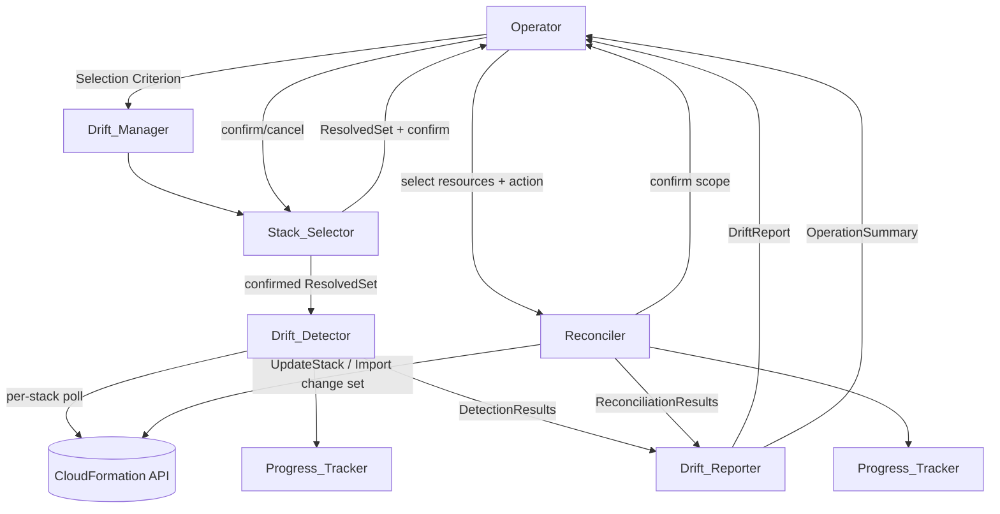
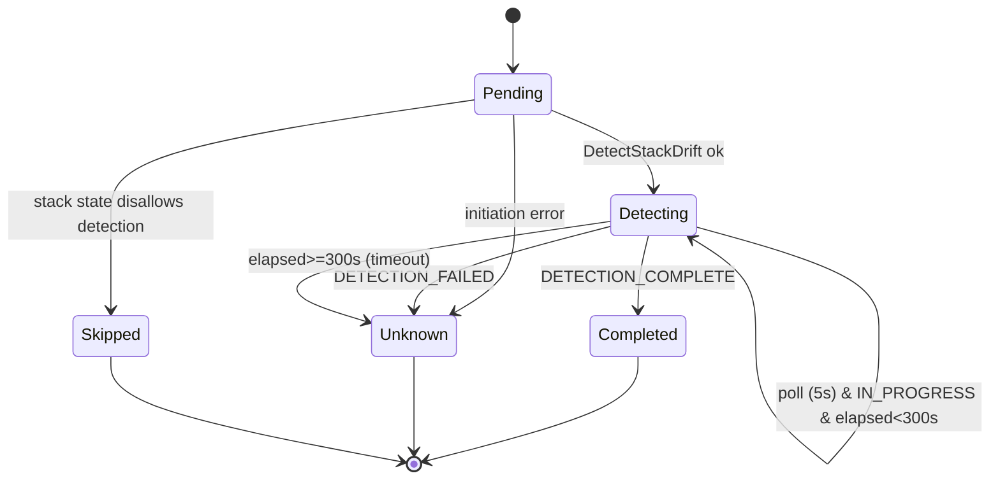

# Design Document

## Overview

The Multi-Stack Drift Manager orchestrates bulk CloudFormation drift detection and reconciliation across up to 500 stacks in a single operation. It resolves a user-supplied selection criterion into a concrete stack set, confirms it with the user, runs bounded-concurrency drift detection, aggregates results into a consolidated report, and performs selective, confirmed reconciliation of drifted resources with continue-on-failure semantics and real-time progress.

### Research summary: CloudFormation drift APIs

The design is built on the AWS CloudFormation drift detection API surface. Key findings that shape the design:

- **`DetectStackDrift`** initiates an asynchronous, per-stack drift detection operation and returns a `StackDriftDetectionId`. It is not synchronous and can take several minutes depending on resource count. ([DetectStackDrift](https://docs.aws.amazon.com/AWSCloudFormation/latest/APIReference/API_DetectStackDrift.html))
- **`DescribeStackDriftDetectionStatus`** is polled with that id. Its `DetectionStatus` is one of `DETECTION_IN_PROGRESS`, `DETECTION_FAILED`, or `DETECTION_COMPLETE`, and `StackDriftStatus` is one of `DRIFTED`, `IN_SYNC`, `UNKNOWN`, `NOT_CHECKED`. `DriftedStackResourceCount` is NULL until the operation reaches `DETECTION_COMPLETE`. ([DescribeStackDriftDetectionStatus](https://docs.aws.amazon.com/boto3/latest/reference/services/cloudformation/client/describe_stack_drift_detection_status.html))
- **`DescribeStackResourceDrifts`** returns per-resource drift once detection completes. Each entry has `LogicalResourceId`, `PhysicalResourceId`, `ResourceType`, `StackResourceDriftStatus` (`IN_SYNC`/`MODIFIED`/`DELETED`/`NOT_CHECKED`/`UNKNOWN`/`UNSUPPORTED`), and `PropertyDifferences` with `PropertyPath`, `ExpectedValue`, `ActualValue`, and `DifferenceType` (`ADD`/`REMOVE`/`NOT_EQUAL`). The response is paginated via `NextToken`. ([DescribeStackResourceDrifts](https://docs.aws.amazon.com/boto3/latest/reference/services/cloudformation/client/describe_stack_resource_drifts.html))
- **CloudFormation has no native "fix drift" API.** Reconciliation must be expressed as a template operation:
  - *Align actual to template* is achieved by updating the stack to re-assert the template definition (a change set / `UpdateStack`), which reverts out-of-band changes. ([Resolve drift](https://docs.aws.amazon.com/AWSCloudFormation/latest/UserGuide/resource-import-resolve-drift.html))
  - *Adopt actual configuration* is achieved via **resource import** using an import change set (`CreateChangeSet` with `ChangeSetType=IMPORT`, then `ExecuteChangeSet`), so CloudFormation begins tracking the actual configuration. ([Remediate drift via resource import](https://aws.amazon.com/blogs/mt/remediate-drift-via-resource-import-with-aws-cloudformation/))

Content was rephrased for compliance with licensing restrictions.

This research drives two design decisions: (1) drift detection is inherently a poll loop, so the Drift_Detector is modeled as a per-stack state machine over the `DetectionStatus` values with an explicit timeout; and (2) because there is no fix-drift primitive, the Reconciler is an adapter that translates two reconciliation intents into template operations (update vs. import change set) and reports their outcome uniformly.

### Scope and goals

- Resolve selection criteria (names / tags / region) to a bounded set (1–500), with mandatory confirmation.
- Detect drift across the set with max concurrency 10, 5s polling, 300s per-stack timeout, and well-defined `UNKNOWN`/skipped terminal outcomes.
- Produce a consolidated, machine-readable report at stack and property level with aggregate counts that conserve the stack total.
- Reconcile selected drifted resources (1–500) with mandatory confirmation, scope invalidation on change, and continue-on-failure.
- Track progress for both operations and emit an operation summary whose counts conserve the item total.

## Architecture

The system is a pipeline of components coordinated by `Drift_Manager`. Each stage produces an immutable artifact consumed by the next, which keeps the report and summary reproducible and testable.



### Component responsibilities

| Component | Responsibility | Primary CFN calls |
|-----------|----------------|-------------------|
| Drift_Manager | Orchestrates phases, holds operation state, enforces confirmation gates | — |
| Stack_Selector | Resolves criterion to a bounded stack set, records unmatched names / region errors | `ListStacks`, `DescribeStacks`, tag filtering |
| Drift_Detector | Per-stack detection state machine, concurrency pool, polling, timeout | `DetectStackDrift`, `DescribeStackDriftDetectionStatus`, `DescribeStackResourceDrifts` |
| Drift_Reporter | Aggregates detection/reconciliation results into report + summary (human + machine-readable) | — |
| Reconciler | Translates reconciliation intent to template op, continue-on-failure | `CreateChangeSet`, `ExecuteChangeSet`, `UpdateStack` |
| Progress_Tracker | Observes in-flight operation, reports total/completed/remaining within 2s | — |

### Concurrency model

The Drift_Detector uses a worker pool capped at 10 in-flight stacks. Each worker owns one stack's detection state machine. A stack occupies a slot from `DetectStackDrift` initiation until it reaches a terminal outcome (recorded status, `UNKNOWN`, or skipped); the slot is then released and the next pending stack admitted. This guarantees the invariant that in-flight count never exceeds 10 regardless of set size.

### Per-stack detection state machine



`Completed`, `Unknown`, and `Skipped` are terminal. Once a stack reaches a terminal state, no further polling or state transition occurs for it — this terminality is relied on by the timeout and completion properties.

## Components and Interfaces

### Stack_Selector

```
resolve(criterion: SelectionCriterion) -> SelectionResult

SelectionResult = Resolved(stacks: Stack[0..500], unmatchedNames: string[])
               | EmptySelection(message)
               | FailedSelection(reason)        // invalid/inaccessible region
               | RejectedSelection(message)      // zero names and zero tag filters

confirm(resolved: Resolved) -> ConfirmedSet       // user confirmed -> detection may proceed
cancel(resolved: Resolved)  -> Aborted            // user cancelled -> no detection
```

Resolution rules:
- Names: exact match; unmatched names excluded and recorded in `unmatchedNames`.
- Tags: AND semantics; every filter must match a stack tag by exact, case-sensitive key and value.
- Region: all stacks in region; invalid/inaccessible region → `FailedSelection`.
- The resolved set is truncated/bounded to at most 500 stacks.
- Zero names and zero tag filters → `RejectedSelection` (validation precedes resolution).
- Zero matches → `EmptySelection`.

### Drift_Detector

```
detectAll(set: ConfirmedSet, cfg = {maxConcurrency:10, pollInterval:5s, perStackTimeout:300s})
    -> DetectionResults

StackDetectionOutcome = {
  stackName, stackId?,
  outcome: Detected(status: DriftStatus, driftedResources: ResourceDrift[])
         | Unknown(reason)
         | Skipped(reason),
}
DetectionResults = { outcomes: StackDetectionOutcome[] }   // exactly one per stack in set
```

Detection loop per stack: initiate `DetectStackDrift`; poll `DescribeStackDriftDetectionStatus` every 5s; on `DETECTION_COMPLETE` fetch `DescribeStackResourceDrifts` (paginated) and record `StackDriftStatus` + drifted resources; on `DETECTION_FAILED` record `Unknown(reason)`; if elapsed ≥ 300s record `Unknown(timeout reason)` and stop; if the stack state disallows detection record `Skipped(reason)`.

### Drift_Reporter

```
report(results: DetectionResults) -> DriftReport
toMachineReadable(report: DriftReport) -> StructuredReport   // e.g. JSON

DriftReport = {
  entries: StackReportEntry[],                 // one per stack, no omission/duplication
  counts: { DRIFTED, IN_SYNC, NOT_CHECKED, UNKNOWN },  // sum == entries.length
  emptyMessage?                                // present only when entries is empty
}
StackReportEntry = { stackName, status: DriftStatus, driftedResources: ResourceDrift[] }
```

Rules: drifted-resource entries present only where `status == DRIFTED`; otherwise empty. Property differences expose expected/actual with explicit absence marker for ADD/REMOVE.

### Reconciler

```
setScope(resources: ResourceDrift[1..500]) -> Scope           // records reconciliation scope
confirmScope(scope, currentSelection) -> ConfirmedScope | ScopeInvalidated | RejectedEmpty
reconcile(scope: ConfirmedScope, action: AlignToTemplate | AdoptActual) -> ReconciliationResults

ReconciliationOutcome = { resourceId, action, result: Succeeded | Failed(reason) | Skipped(reason) }
ReconciliationResults = { outcomes: ReconciliationOutcome[], total, succeeded, failed }
```

Action translation (no native fix-drift API):
- `AlignToTemplate` → re-assert template via change set / `UpdateStack`; on success set resource drift status to in-sync.
- `AdoptActual` → import actual config via `CreateChangeSet(ChangeSetType=IMPORT)` + `ExecuteChangeSet`; on success set resource drift status to in-sync.

Continue-on-failure: a failed resource records `Failed(reason)`, leaves its prior drift status unchanged, and processing continues for remaining resources. Confirmation is mandatory before any action; if the selection changes after `setScope` and before confirm, the scope is invalidated and must be re-confirmed.

### Progress_Tracker

```
observe(operation) -> ProgressSnapshot
ProgressSnapshot = { total, completed, remaining, failures: Failure[] }   // completed + remaining == total
```

Updates reflect any item status change within 2 seconds. Per-item failures are recorded and included in progress; the operation continues. On completion, reports complete plus an operation summary of succeeded/failed counts.

## Data Models

```
SelectionCriterion =
  | Names(names: string[0..500])
  | Tags(filters: {key, value}[0..500])          // AND, exact, case-sensitive
  | Region(region: string)

DriftStatus = DRIFTED | IN_SYNC | NOT_CHECKED | UNKNOWN

ResourceDrift = {
  logicalResourceId: string,
  physicalResourceId?: string,
  resourceType: string,
  resourceDriftStatus: MODIFIED | DELETED | IN_SYNC | NOT_CHECKED | UNKNOWN | UNSUPPORTED,
  propertyDifferences: PropertyDifference[]
}

PropertyDifference = {
  propertyPath: string,
  expectedValue: Value | ABSENT,     // ABSENT when DifferenceType == ADD (only in actual)
  actualValue: Value | ABSENT,       // ABSENT when DifferenceType == REMOVE (only in expected)
  differenceType: ADD | REMOVE | NOT_EQUAL
}

OperationSummary = {
  kind: Detection | Reconciliation,
  items: SummaryItem[],
  succeeded: int, failed: int, skipped: int   // succeeded+failed+skipped == items.length
}
SummaryItem = { id, outcome: Succeeded | Failed | Skipped, reason? }  // reason present for Failed/Skipped
```

The `ABSENT` marker models requirement 3.5's "absence of a value" for add-only / remove-only differences, mapping directly to the CloudFormation `DifferenceType` enum.

## Correctness Properties

*A property is a characteristic or behavior that should hold true across all valid executions of a system — essentially, a formal statement about what the system should do. Properties serve as the bridge between human-readable specifications and machine-verifiable correctness guarantees.*

These properties target the pure orchestration logic (selection resolution, aggregation, scope/gating control flow, concurrency bounds, continue-on-failure). The CloudFormation API is mocked so behavior is tested independently of AWS. Properties were consolidated per the prework reflection to remove redundant count-conservation, bijection, and continue-on-failure duplicates.

### Property 1: Explicit names resolve to exact matches

*For any* stack inventory and *any* list of 1–500 submitted stack names, the resolved set equals exactly the set of inventory stacks whose name exactly matches a submitted name.

**Validates: Requirements 1.1, 1.5**

### Property 2: Tag filters match by exact case-sensitive AND semantics

*For any* stack inventory and *any* list of 1–500 tag filters, a stack is in the resolved set if and only if, for every filter, the stack carries a tag whose key and value both exactly (case-sensitively) equal the filter's key and value.

**Validates: Requirements 1.2**

### Property 3: Region criterion resolves to all stacks in the region

*For any* multi-region stack inventory and *any* target region, the resolved set equals exactly the set of inventory stacks located in that region.

**Validates: Requirements 1.3**

### Property 4: Resolution never exceeds 500 stacks

*For any* selection criterion and *any* inventory, the resolved set contains at most 500 stacks.

**Validates: Requirements 1.4**

### Property 5: Detection is gated on confirmation

*For any* resolved set, no drift detection is initiated for any stack before the resolved set has been presented for confirmation; and if the user cancels, no drift detection is initiated for any stack.

**Validates: Requirements 1.9, 1.11**

### Property 6: Concurrency never exceeds the bound

*For any* confirmed set of stacks, at every instant during bulk detection the number of stacks with an in-flight (initiated but not yet terminal) detection is at most 10.

**Validates: Requirements 2.1**

### Property 7: Completed detection records the reported stack status

*For any* stack whose detection reaches completion with a reported stack-level drift status, the recorded outcome's drift status equals the reported status.

**Validates: Requirements 2.3**

### Property 8: Non-completion yields a terminal UNKNOWN with reason

*For any* stack whose detection fails or does not complete within the 300s per-stack timeout, the recorded outcome is `UNKNOWN` with a stored reason, and no further polling or state transition occurs for that stack afterward.

**Validates: Requirements 2.4, 2.6**

### Property 9: Detection-disallowed stacks are skipped without initiation

*For any* stack in a state that does not permit drift detection, the recorded outcome is a skipped outcome with a reason, and no detection is initiated for that stack.

**Validates: Requirements 2.5**

### Property 10: Bulk detection terminates with exactly one terminal outcome per stack

*For any* confirmed set, bulk detection signals completion if and only if every stack in the set has exactly one recorded terminal outcome (detected status, `UNKNOWN`, or skipped).

**Validates: Requirements 2.7**

### Property 11: Report is a bijection over the resolved set

*For any* detection results over a resolved set, the multiset of stacks in the report (and in the detection operation summary) equals the multiset of stacks in the resolved set — every stack appears exactly once, none omitted or duplicated — each paired with its final drift status.

**Validates: Requirements 3.1, 6.1**

### Property 12: Drifted resources are shown if and only if the stack is DRIFTED

*For any* stack report entry, the entry lists its recorded drifted resources (each with resource identifier and resource type) when its status is `DRIFTED`, and lists no drifted resources otherwise.

**Validates: Requirements 3.3, 3.4**

### Property 13: Property differences expose expected/actual with correct absence marker

*For any* drifted resource with property-level differences, each difference exposes its property identifier, expected value, and actual value, where the expected value is marked absent exactly when the difference is add-only and the actual value is marked absent exactly when the difference is remove-only.

**Validates: Requirements 3.5**

### Property 14: Status counts conserve the stack total

*For any* consolidated report over a resolved set, each of the four status counts (`DRIFTED`, `IN_SYNC`, `NOT_CHECKED`, `UNKNOWN`) equals the number of stacks with that status (zero where none), and the four counts sum to the number of stacks in the resolved set.

**Validates: Requirements 3.6**

### Property 15: Machine-readable report round-trips report data

*For any* consolidated report, parsing its machine-readable structured form reconstructs, for every stack entry, its drift status and its drifted-resource entries, and for every drifted-resource entry its resource identifier, resource type, and property-level differences — without reference to presentation formatting.

**Validates: Requirements 3.7**

### Property 16: Selected resources are recorded as the reconciliation scope

*For any* selection of 1–500 drifted resources, the recorded reconciliation scope equals exactly the selected resources.

**Validates: Requirements 4.1**

### Property 17: Changing the selection invalidates the recorded scope

*For any* recorded reconciliation scope, if the set of selected drifted resources changes before confirmation, the scope is invalidated and no reconciliation action is applied until the updated scope is re-confirmed.

**Validates: Requirements 4.3**

### Property 18: Reconciliation is gated on confirmation and covers every scoped resource

*For any* reconciliation scope, no reconciliation action is applied to any resource before explicit confirmation; and upon confirmation the chosen action is applied exactly once to each resource in the scope.

**Validates: Requirements 4.4, 4.10**

### Property 19: Successful reconciliation sets the resource to in-sync

*For any* scoped resource whose reconciliation succeeds, align-to-template re-asserts the template definition (template update) and adopt-actual imports the actual configuration, and in both cases the resource's drift status is set to in-sync.

**Validates: Requirements 4.5, 4.6**

### Property 20: Failures are isolated and processing continues

*For any* confirmed reconciliation scope with arbitrary failures injected, each failed resource records a failed outcome with a reason and retains its prior drift status, every other resource in the scope is still processed, and each recorded failure is reflected in the reported progress.

**Validates: Requirements 4.7, 4.8, 5.4**

### Property 21: Progress conserves the item total

*For any* in-flight bulk operation (detection or reconciliation), at every observed instant the reported completed count plus remaining count equals the reported total count.

**Validates: Requirements 5.1, 5.2**

### Property 22: Operation summaries conserve the item total

*For any* operation summary (detection or reconciliation), the succeeded, failed, and skipped counts each equal the number of items with that outcome and together sum to the total number of items listed, and reconciliation summaries list every targeted resource with an outcome of succeeded, failed, or skipped.

**Validates: Requirements 4.9, 5.5, 6.2, 6.3**

### Property 23: Failed and skipped summary items carry identifier and reason

*For any* operation summary, every item whose outcome is failed or skipped exposes its item identifier and a recorded reason.

**Validates: Requirements 6.4**

## Error Handling

| Condition | Component | Behavior |
|-----------|-----------|----------|
| Zero names and zero tag filters | Stack_Selector | Reject criterion with "at least one stack name or tag filter required" (1.6) |
| Invalid / inaccessible region | Stack_Selector | Return `FailedSelection` with recorded region error reason (1.7) |
| Criterion matches no stack | Stack_Selector | Return `EmptySelection` with "no stacks matched" message (1.8) |
| Submitted name has no matching stack | Stack_Selector | Exclude name, record in `unmatchedNames` for the summary (1.5) |
| `DetectStackDrift` initiation error | Drift_Detector | Record `UNKNOWN` with reason (2.4) |
| `DetectionStatus == DETECTION_FAILED` | Drift_Detector | Record `UNKNOWN` with the `DetectionStatusReason` (2.4) |
| Per-stack timeout (≥300s) | Drift_Detector | Stop waiting, record `UNKNOWN` with timeout reason; outcome is terminal (2.6) |
| Stack state disallows detection | Drift_Detector | Skip, record skipped outcome with reason; never initiate (2.5) |
| Empty report | Drift_Reporter | Emit report with no entries and descriptive empty message (3.2) |
| Empty reconciliation scope confirmed | Reconciler | Reject, retain scope, require ≥1 resource (4.2) |
| Selection changed after scope recorded | Reconciler | Invalidate scope, require re-confirmation (4.3) |
| Single resource reconciliation fails | Reconciler | Record `Failed(reason)`, leave prior drift status, continue remaining (4.8) |
| Summary production fails | Drift_Reporter | Present error indication, preserve recorded per-item outcomes (6.5) |
| Transient CFN API errors (throttling) | Drift_Detector / Reconciler | Bounded retry with backoff within the per-stack timeout window; exhaustion maps to `UNKNOWN`/`Failed` |

All CloudFormation errors are captured as the recorded `reason` so they surface in the report and operation summary rather than aborting the bulk operation.

## Testing Strategy

Property-based testing is appropriate here: the orchestration logic is a set of pure transformations and state machines (selection resolution, aggregation, count conservation, scope/gating control flow, concurrency bounds, continue-on-failure) with large input spaces (arbitrary stack inventories, name/tag/region criteria, drift results, failure injections). The CloudFormation API is the I/O boundary and is mocked so these properties are tested independently of AWS.

### Dual testing approach

**Property-based tests** (one per property in Correctness Properties):
- Use a property-based testing library for the implementation language (e.g., fast-check for TypeScript, Hypothesis for Python, QuickCheck for Haskell). Do not implement PBT from scratch.
- Each property test runs a minimum of 100 iterations.
- Each test is tagged with a comment referencing its design property, in the format:
  `Feature: multi-stack-drift-manager, Property {number}: {property_text}`
- Generators: stack inventories (names, regions, tag maps), selection criteria of each kind, mocked detection reports across all `DetectionStatus`/`StackDriftStatus`/`DifferenceType` values, reconciliation scopes of size 1–500, and random failure injection positions. The AWS client is a mock/fake that returns generated outcomes and records call counts/timing (via a fake clock) so timing and gating can be asserted deterministically.

**Example-based unit tests** (concrete scenarios and edge cases that do not generalize):
- 1.6 — zero names and zero filters → rejected with message.
- 1.7 — invalid/inaccessible region → `FailedSelection` with reason.
- 1.8 — zero matches → `EmptySelection`.
- 1.10 — confirm → detection proceeds on the resolved set.
- 2.2 — 5s poll cadence with a fake clock until completion.
- 3.2 — empty resolved set → empty report with message.
- 4.2 — empty scope confirmed → rejected, scope unchanged.
- 5.3 — status change reflected in progress within 2s (fake clock).
- 6.5 — summary production failure → error indication, outcomes preserved.

**Integration tests** (thin, 1–3 representative examples, against a mocked or sandbox CloudFormation):
- End-to-end detect → report → reconcile happy path for a small stack set.
- Resource import (adopt-actual) change-set execution path.
- Template-update (align-to-template) path.

These verify wiring to `DetectStackDrift`, `DescribeStackDriftDetectionStatus`, `DescribeStackResourceDrifts`, `CreateChangeSet`/`ExecuteChangeSet`, and `UpdateStack`; they are not property tests because behavior there is dominated by external service responses, not input variation.
